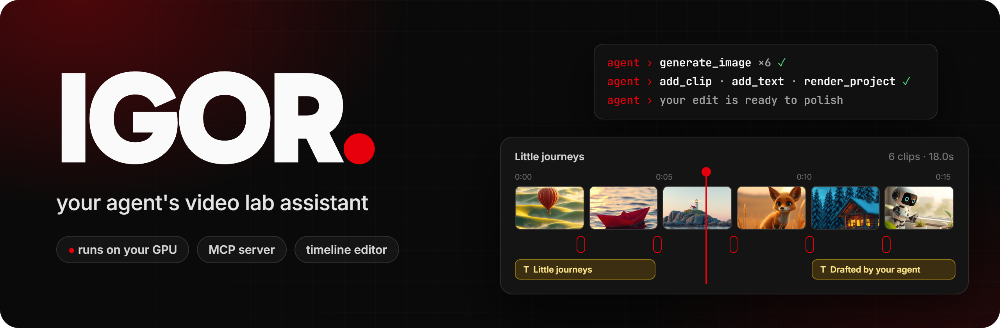
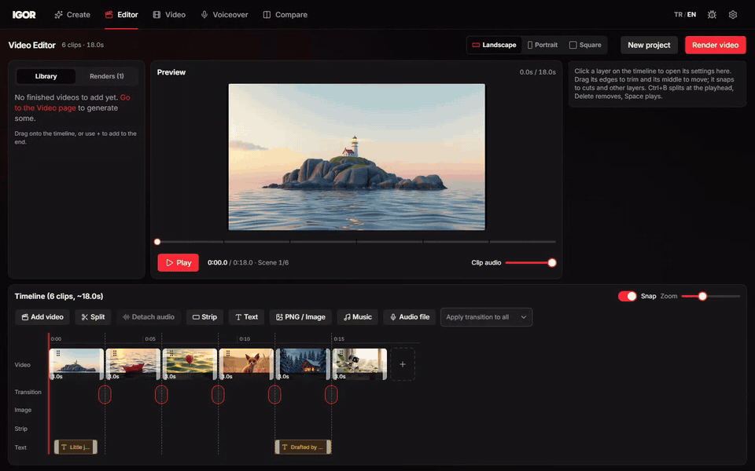
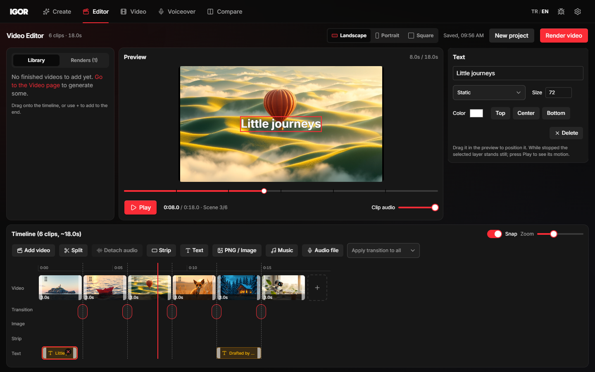
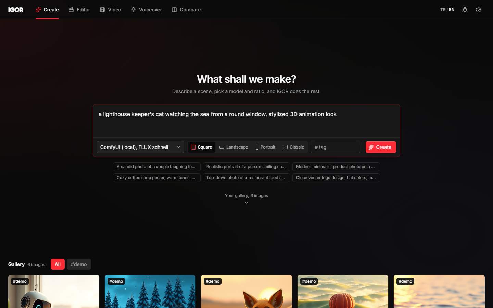
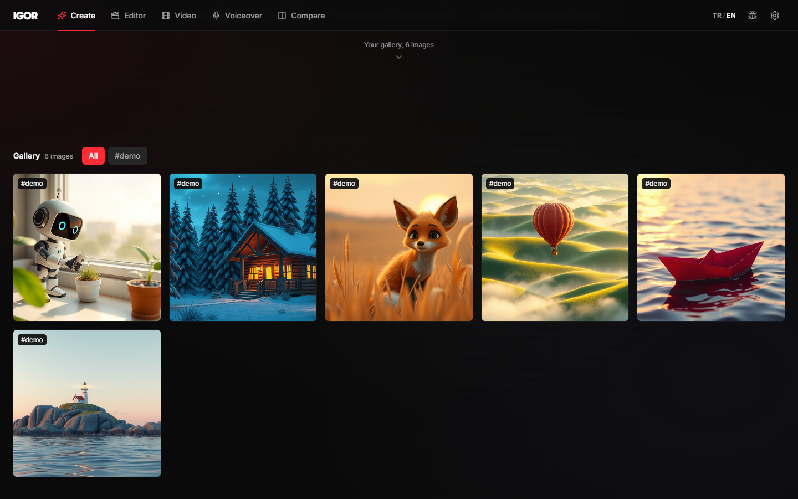
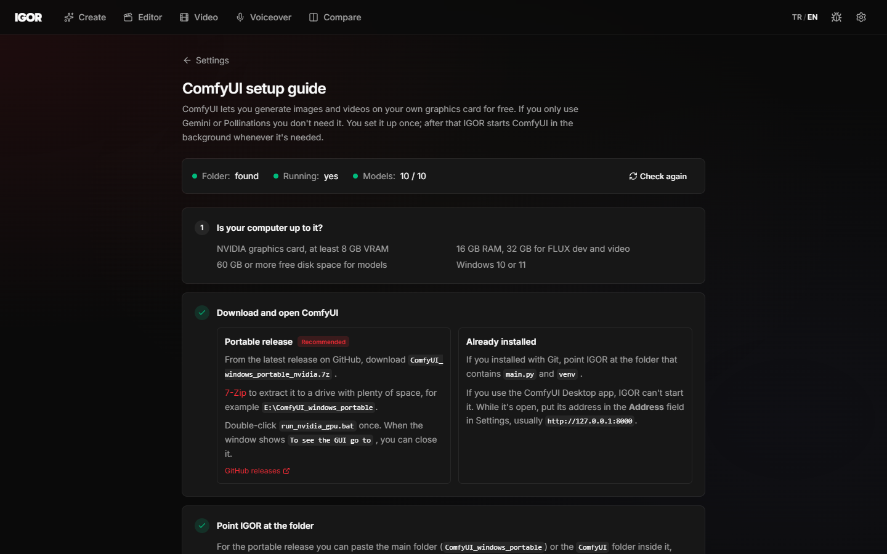

<p align="center"></p>

<p align="center">
  
  
  
</p>

**A free, local AI video editor that your agents can drive.** The agent drafts the edit, you polish it.

## Free, for real

- **No price, no subscription, no account.** IGOR is free and open source under the MIT license, including for commercial use.
- **No usage limits or watermarks.** Generate and render as much as your hardware allows.
- **Runs offline on your own GPU.** With local models (FLUX, LTX-2.3 via ComfyUI) generation costs nothing but electricity.
- **No telemetry.** Nothing you make leaves your machine unless you choose a cloud provider.
- **Cloud is optional, bring your own key.** Gemini and Pollinations are there if you want them; you pay those providers directly, IGOR adds nothing on top.

IGOR runs on your own GPU. It generates images, video clips and voiceovers with local models (via ComfyUI) or your own cloud API keys, and puts them on a timeline editor that renders to MP4 with ffmpeg. An MCP server lets Claude Code, Cursor and other agents generate images, build and render editor projects, which you then open in the same editor.

> Status: early development. The desktop shell and a first MCP server run; the installer is being built, see [docs/ROADMAP.md](docs/ROADMAP.md).



*Six images generated with local FLUX, put on a timeline with transitions and captions, and rendered, all through the MCP server. Then opened in the editor for polishing.*

[Türkçe](#türkçe)

## Features

- **Timeline editor**: video and image clips, trimming, transitions, text overlays, lower thirds, music and voiceover tracks, MP4 export.
- **Image generation**: local FLUX (schnell / dev) through ComfyUI, or Gemini and Pollinations with your own key.
- **Video generation**: local LTX-2.3 image-to-video through ComfyUI, with a background job queue that survives restarts.
- **Character consistency**: one reference image and seed reused across scenes.
- **Text to speech**: Gemini TTS voices with style presets.
- **Tags**: group everything you make by project, client or channel.
- **UI language**: English and Turkish, switchable from the top bar or Settings (defaults to your system language).

## Screenshots

| Timeline editor | Image generation and gallery |
| --- | --- |
|  |  |
| **Gallery** | **ComfyUI setup guide with a live model checklist** |
|  |  |

## Requirements

- Windows 10/11 with an NVIDIA GPU (8 GB VRAM minimum, 12 GB+ recommended) and 32 GB RAM for video.
- Node.js 20+
- [ComfyUI](https://github.com/comfyanonymous/ComfyUI) with the models you want to use. Models are not bundled; each has its own license (FLUX.1-dev and LTX-2 have non-commercial or revenue-limited terms, check them before commercial use).

## Install with your agent

The quickest way: paste this into Claude Code, Cursor or any coding agent that can run commands on your machine, and let it do the setup.

```text
Install IGOR (https://github.com/ilkay-bora/igor-app) on this Windows machine and set it up for me:
1. Check the requirements: Node.js 20+, git, an NVIDIA GPU (nvidia-smi). Tell me if anything is missing and how to get it.
2. Clone the repo into a folder on a drive with plenty of free space, then run `npm install` and `npm run desktop:build`.
3. Ask me if I already have ComfyUI. If not, don't download models yourself; point me to the in-app guide (Settings, then "ComfyUI setup guide").
4. Register the MCP server so you can drive IGOR: `claude mcp add igor -- node <repo>/packages/mcp/src/index.js` (or the equivalent for your client).
5. When the app is open, confirm it works by calling the IGOR MCP tool `list_projects`, then tell me what to do next.
Don't ask me for API keys; I can add Gemini/Pollinations keys later in Settings if I want them.
```

Prefer doing it by hand? Follow the steps below.

## Getting started

```bash
git clone https://github.com/ilkay-bora/igor-app.git
cd igor-app
npm install
npm run desktop:build   # builds the studio and opens the desktop app
```

- **First run** opens a short setup screen: paste your Gemini / Pollinations keys (optional) and point IGOR at your ComfyUI folder. Everything can be changed later under **Settings**. Values are stored locally in `apps/studio/data/settings.json`; `apps/studio/.env.local` still works as a fallback.
- **No ComfyUI yet?** The in-app guide (Settings, then "ComfyUI setup guide") walks through the portable release from GitHub, where each model file goes, and checks live which ones are installed. Git installs (`venv`/`.venv`) and the portable layout (`python_embeded`) are both detected, and IGOR starts ComfyUI in the background without a console window.
- **Desktop shortcut**: every `npm run build` creates or refreshes an `IGOR` shortcut on your Windows desktop (`npm run shortcut` does it on demand). After that, open IGOR from the shortcut or with `npm run desktop`.
- The app opens on the create page, and signs itself in with a local token. Closing the window quits IGOR; if jobs are still running it waits in the tray and quits once they finish. The ComfyUI instance IGOR started stops with it, and after 10 idle minutes. `npm run dev` runs the studio in a browser at http://localhost:3000 for development. On first start it creates a local sign-in token (`apps/studio/data/local-token`) and prints a one-click sign-in link in the terminal; `APP_TOKEN` in `.env.local` overrides it.

## MCP server (agents)

`packages/mcp` is a stdio MCP server that drives the running IGOR app through its local API. Add it to Claude Code:

```bash
claude mcp add igor -- node /path/to/igor-app/packages/mcp/src/index.js
```

Or in any client's JSON config: `{"command": "node", "args": ["/path/to/igor-app/packages/mcp/src/index.js"]}`.

It finds IGOR by itself: the desktop app's `server.json` while it runs, otherwise a dev server on `localhost:3000` with the token from `apps/studio/.env.local` or `data/local-token`. `IGOR_URL` + `IGOR_TOKEN` override both.

Tools: `generate_image`, `list_media`, `create_project`, `list_projects`, `get_project`, `add_clip`, `remove_clip`, `add_text`, `render_project`, `get_render`, `open_in_editor`. A typical run: generate a few images, create a vertical project, add them as clips with transitions, add a caption, render, and hand the user the editor link (`/video/editor?project=<id>`) to polish it.

A runnable example of the whole flow is in [`packages/mcp/examples/demo-project.mjs`](packages/mcp/examples/demo-project.mjs); it made the demo at the top of this page.

Images added as clips become short MP4 clips at the project resolution, so they play and trim in the editor like any video. A cold ComfyUI start takes over a minute; the server sends progress heartbeats so clients that support them keep waiting.

## Project layout

```
apps/studio     Next.js app: UI and local API
apps/desktop    Electron shell: window, tray, starts the studio server
packages/mcp    MCP server (npm name igor-mcp), talks to the studio API
docs/           Roadmap, README images
```

Planned: `packages/core` (engine shared by UI, API and MCP).

## Changelog

See [CHANGELOG.md](CHANGELOG.md).

## License

MIT: free to use, modify and share, commercially too. Model weights you download are covered by their own licenses.

---

## Türkçe

**Agent'larının da kullanabildiği ücretsiz, lokal bir AI video editörü.** Agent taslağı kurgular, sen cilalarsın.

**Tamamen ücretsiz:** fiyat, abonelik, hesap yok. MIT lisanslı açık kaynak, ticari kullanım dahil. Kullanım limiti ve filigran yok, telemetri yok. Lokal modellerle (ComfyUI) üretim bedava, bulut sağlayıcılar (Gemini, Pollinations) isteğe bağlı ve kendi anahtarınla çalışır, IGOR üstüne bir şey eklemez.

IGOR kendi GPU'nda çalışır. Lokal modellerle (ComfyUI üzerinden) ya da kendi API anahtarlarınla görsel, video ve seslendirme üretir, bunları ffmpeg ile MP4'e render eden bir timeline editörüne koyar. MCP sunucusu (`packages/mcp`) sayesinde Claude Code, Cursor gibi agent'lar görsel üretip proje kurabilir ve render alabilir, sen de aynı projeyi editörde açıp düzeltirsin.

**Agent'ına kurdur:** en kolayı, şu metni Claude Code, Cursor gibi bilgisayarında komut çalıştırabilen bir agent'a yapıştırmak:

```text
IGOR'u (https://github.com/ilkay-bora/igor-app) bu Windows bilgisayara kur ve benim için ayarla:
1. Gereksinimleri kontrol et: Node.js 20+, git, NVIDIA GPU (nvidia-smi). Eksik varsa söyle ve nasıl kuracağımı anlat.
2. Repo'yu boş yeri bol bir sürücüde bir klasöre klonla, sonra `npm install` ve `npm run desktop:build` çalıştır.
3. ComfyUI'ım olup olmadığını sor. Yoksa modelleri kendin indirme, beni uygulamadaki rehbere yönlendir (Ayarlar, sonra "ComfyUI kurulum rehberi").
4. IGOR'u kullanabilmen için MCP sunucusunu ekle: `claude mcp add igor -- node <repo>/packages/mcp/src/index.js` (ya da kullandığın istemcideki karşılığı).
5. Uygulama açılınca IGOR MCP aracı `list_projects` ile çalıştığını doğrula, sonra ne yapmam gerektiğini söyle.
Benden API anahtarı isteme, istersem Gemini/Pollinations anahtarlarını sonra Ayarlar'dan eklerim.
```

Elle kurmak istersen yukarıdaki "Getting started" adımlarını izle. Kısaca: `npm install` ve `npm run desktop:build`. İlk açılışta API anahtarlarını ve ComfyUI klasörünü soran bir kurulum ekranı gelir, bunları sonra Ayarlar'dan değiştirebilirsin. ComfyUI kurulu değilse uygulamadaki rehber GitHub'dan indirmeyi ve model dosyalarını adım adım anlatır. Her build sonrası masaüstüne bir IGOR kısayolu konur. Yol haritası: [docs/ROADMAP.md](docs/ROADMAP.md).
